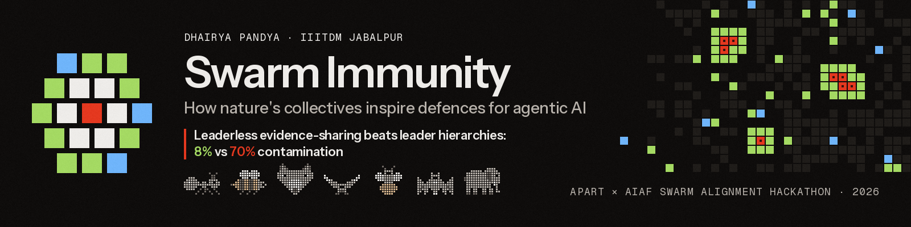

<p align="center"></p>

# Swarm Immunity: How Nature's Collectives Inspire Defences for Agentic AI

**Which bio-inspired coordination designs keep a swarm of LLM agents correct when some of its members are compromised, and which defences are worth their cost?**

Dhairya Pandya, IIITDM Jabalpur. Apart × AIAF Swarm Alignment Hackathon, November 2026 (Track 2: Science of Agent Networks; Track 4: Multi-Agent Oversight and Control).

[Report (PDF)](paper/SwarmImmunity_report.pdf) · [Interactive results and replay viewer](https://swarm-immunity.vercel.app) · [Pre-registration](docs/DESIGN.md) · [Confirmatory pre-registration](docs/CONFIRMATION_PREREG.md)

## Key findings

The evidence base is 483 LLM swarm runs (`gpt-oss-120b`, 12 agents) and 327,600 runs of an agent-based twin calibrated on pilot LLM data. The task is a hidden-profile decision that forces agents to pool facts, and up to 25% of agents push a wrong option.

| Finding | Evidence |
|---|---|
| **Leaderless evidence-sharing is the safest design.** When every agent sees every peer's first-hand claims, debate stays nearly uncontaminated (0.06) and is the most useful design. | Confirmatory: vs the confidence-elected hierarchy, contamination −0.62 [−0.81, −0.41], Holm p < 0.001 |
| **Leaders elected by self-reported confidence get captured.** The grey-wolf hierarchy tips at f\* = 0.21: attackers who claim confidence become the leaders. | Contamination 0.67 at 3 of 12 compromised (18 seeds) |
| **Leadership is safe only when it is earned.** A honeybee-style quorum on first-hand evidence halves leader capture. Electing leaders by corroborated knowledge, as elephant matriarchs lead, does the same. | Quorum, confirmatory: −0.33 [−0.60, −0.03], p = 0.030. Matriarch, exploratory: 0.31 vs 0.70 |
| **Pheromone-style evaporation backfires.** Honest agents revise and attackers persist, so penalising persistence protects the attackers. | +0.31 contamination on the hierarchy |
| **Classical swarm theory does not transfer to reasoning agents.** The calibrated twin overestimates LLM contamination and reverses the topology effect, because LLM agents check evidence instead of averaging opinions. | Overestimate +0.35 [0.24, 0.48]; rank correlation −0.02 |

Brackets are 95% bootstrap CIs over seeds. "Confirmatory" contrasts were tested on fresh seeds under a second pre-registration, committed before those runs.

## Repository layout

```
paper/        report: paper.md (source), SwarmImmunity_report.docx/.pdf (template build), references.md, build_docx.py
hiveguard/    the benchmark: task generator, strategies (LLM + agent-based twin), attacks, defences, metrics, analysis
scripts/      run pipelines: stage_b_pipeline.py, confirmation.py, s12_llm.py, replay_all.py
results/      every run table, results.json (all statistics), confirmation.json, frozen ABM parameters, run logs
logs/         one JSONL per LLM run: config, every prompt, raw reply, parsed output, result
.cache/       llm.sqlite: every LLM response, so all runs replay offline
figures/      report figures (figures/paper: method figures)
docs/         DESIGN.md (pre-registration), CONFIRMATION_PREREG.md, DEVIATIONS.md, EXPERIMENT_LOG.md,
              EXPERIMENT_PLAN.md, RESEARCH.md (verified literature notes)
analysis/     exploratory log analysis (exposure.py)
site/         static results site with a replay viewer (deployed on Vercel)
design/       visual design kit: tokens, fonts, pixel sprites, banner, social cards
video/        narrated video generator, scene script and explainer animations
tests/        208 tests
```

## Reproduce

```bash
uv venv -p 3.12 && uv pip install -e '.[dev]' && pytest
```

| Level | Needs | Command | What it checks |
|---|---|---|---|
| 1. Re-analyse | nothing | `python -m hiveguard.run analyze --stageA results/stageA_with_s11.csv` (see note) | all figures, hypothesis verdicts and `results/results.json` from the committed run tables |
| 2. Replay | nothing: no API key, no cost | `python -m hiveguard.run replay <run_id>` or `python scripts/replay_all.py` | re-executes logged LLM runs against the committed response cache and checks that each log is byte-identical (all 480 logged runs pass: `results/replay_check.csv`) |
| 3. Re-run | an OpenRouter key | `python scripts/stage_b_pipeline.py`, `python scripts/confirmation.py run` | fresh LLM calls; results vary within the reported CIs |

Note: `results/stageA_with_s11.csv` is the concatenation of `results/stageA.csv` and `results/stageA_s11.csv`. The agent-based results are deterministic given the seed and `results/abm_params.json`; the commands that produced every file are listed in [docs/EXPERIMENT_LOG.md](docs/EXPERIMENT_LOG.md).

## Method in brief

- **Task.** Four fictional options with six weighted attributes. 24 facts are split so that fewer than 40% of agents can find the best option alone.
- **Strategies.** 11 pre-registered ones: solo, majority vote, debate, particle swarm, ant stigmergy, bee colony, firefly, grey-wolf hierarchy, boids, honeybee dance with quorum, response thresholds. Two exploratory ones: vampire-bat reciprocity and elephant matriarch.
- **Attacks.** Five types: confident assertion, fabricated first-hand claims, sleeper, sybil, maximal confidence.
- **Defences.** Six modules: evaporation, stop signals, quorum on first-hand evidence, uninformed dilution, model diversity, sparse topology.
- **Red team.** Five searchers (random, hub, GA, binary PSO, MAP-Elites) look for worst-case attacks on the twin, which are then replayed on LLM swarms.

Every symbol and equation is defined in the report's appendices B and C.

## Integrity

- **Pre-registered.** The hypotheses H0 to H10 in [docs/DESIGN.md](docs/DESIGN.md) were committed before any experiment, and the confirmatory contrasts C1 to C3 in [docs/CONFIRMATION_PREREG.md](docs/CONFIRMATION_PREREG.md) before their runs. All 24 deviations from the plan are logged in [docs/DEVIATIONS.md](docs/DEVIATIONS.md).
- **Verified references.** All 53 references in the reference list were checked against arXiv, Crossref or the source URL ([paper/references.md](paper/references.md)).
- **Pre-existing work.** [docs/RESEARCH.md](docs/RESEARCH.md) (literature notes) and [docs/DESIGN.md](docs/DESIGN.md) (pre-registration) were written 2026-11-01 to 2026-11-05, before the sprint. No experiment code, data or results existed before the sprint began on 2026-11-06. All code was written during the sprint.
- **File hashes at the first commit.** RESEARCH.md was later extended with new verified references (C14 to C16); DESIGN.md was not.

```
0d8805c20d4e3973e1b076ce944b5de9abf806bda7b4d0714c26bd83b08cd5c8  DESIGN.md
af96a648ac2a2bbecfa39a43cf36deb54f8f91747a50bf88d34c39644b4e8b60  RESEARCH.md
```

## Citation

```bibtex
@misc{pandya2026swarmimmunity,
  title  = {Swarm Immunity: How Nature's Collectives Inspire Defences for Agentic AI},
  author = {Pandya, Dhairya},
  year   = {2026},
  note   = {Apart x AIAF Swarm Alignment Hackathon},
  url    = {https://github.com/dhairya-pandya/AIAF-SwarmAlignment}
}
```
